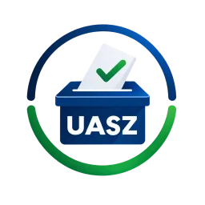
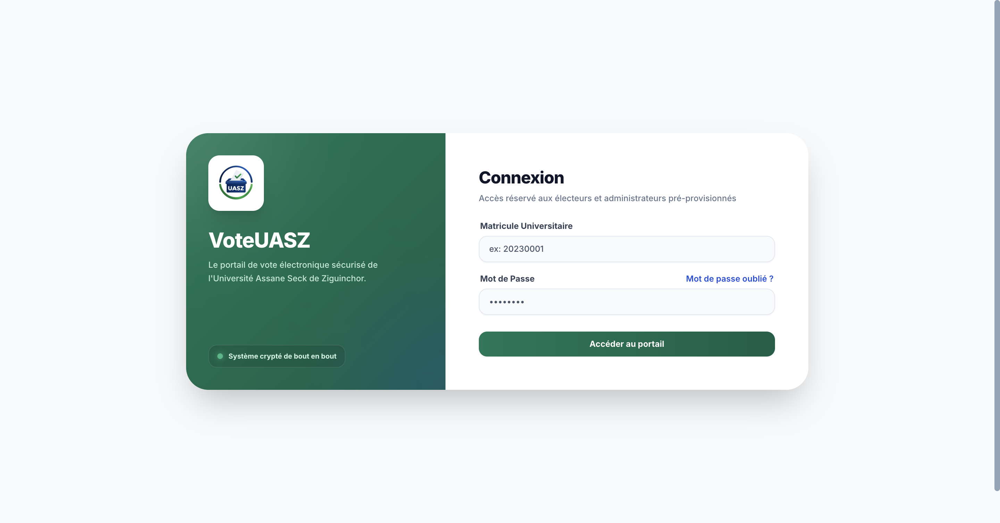
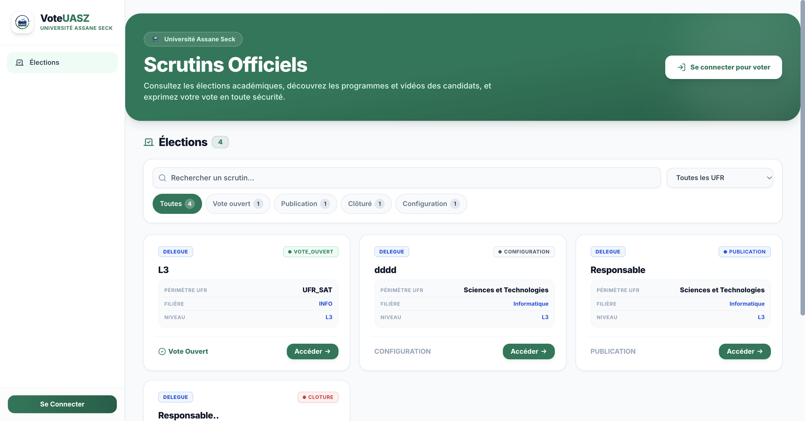
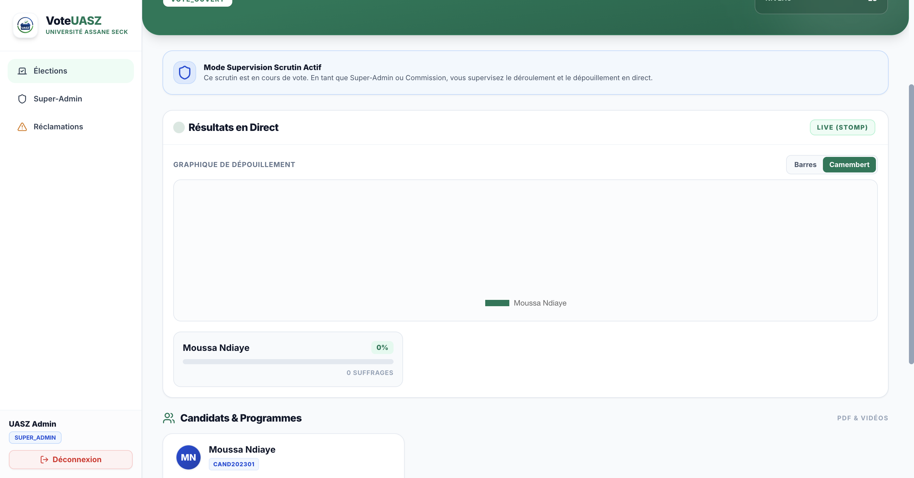
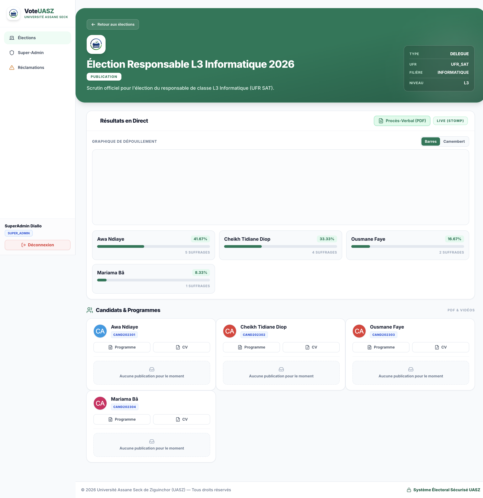
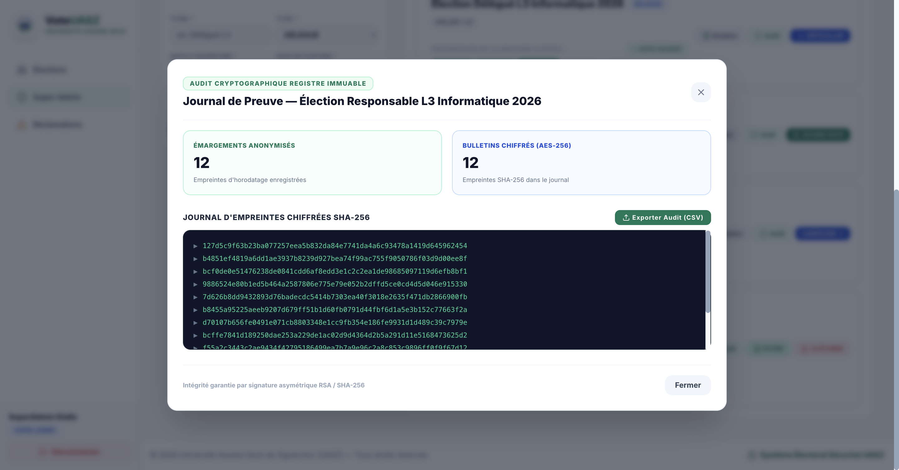
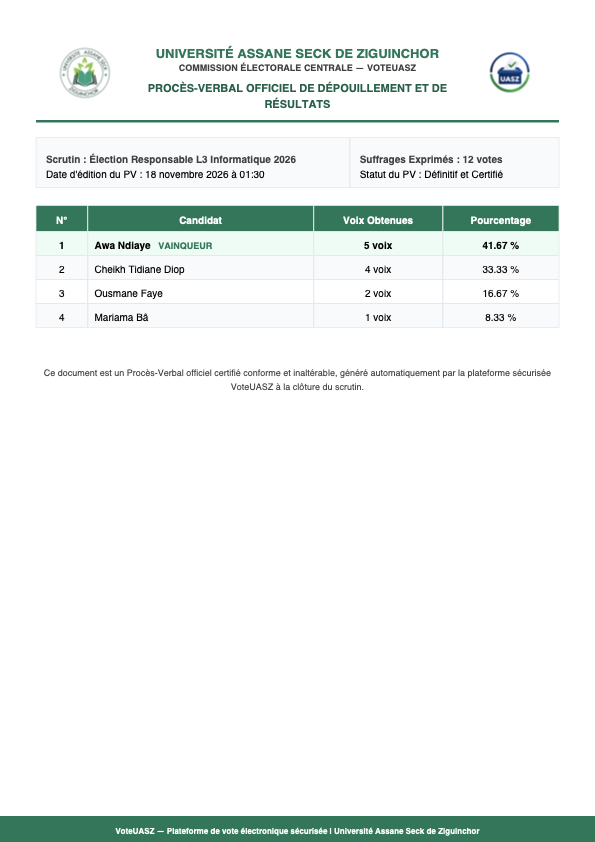

<div align="center">



# VoteUASZ — Plateforme de Vote Électronique Universitaire

**Système de vote électronique sécurisé, chiffré (AES-256-GCM) et mobile-first, développé pour l'Université Assane Seck de Ziguinchor (UASZ).**

[](https://github.com/ona79/VoteUASZ/actions/workflows/ci.yml)
[](https://vote-uasz-frontend.vercel.app)
[](https://voteuasz-backend-r5cn.onrender.com/api/v1/elections)


**[🌐 Plateforme en ligne](https://vote-uasz-frontend.vercel.app)** · **[⚡ API Backend](https://voteuasz-backend-r5cn.onrender.com/api/v1/elections)** · **[📘 OpenAPI](./docs/openapi.yaml)** · **[📐 Diagrammes UML](./docs/UML/README.md)** · **[📄 Mémoire PDF](./docs/rapport_latex/main.pdf)**

</div>

---

## À Propos

**VoteUASZ** dématérialise les scrutins universitaires de l'UASZ (`DELEGUE`, `DUFR`, `VICE_RECTEUR`) avec :
- **Machine à états stricte** : `CONFIGURATION → CAMPAGNE → VOTE_OUVERT → DEPOUILLEMENT → PUBLICATION → CLOTURE`
- **4 rôles RBAC** : `SUPER_ADMIN`, `COMMISSION_ELECTORALE`, `CANDIDAT`, `ELECTEUR`
- **Anonymat & intégrité** : séparation structurelle entre l'émargement (`VoterAuditLog`) et le bulletin (`Ballot` UUID sans clé vers `User`), chiffrement **AES-256-GCM** et chaînage **SHA-256**

---

## Aperçu de l'Interface

| Connexion sécurisée | Liste des scrutins |
|---|---|
|  |  |

| Vote sécurisé par OTP | Résultats temps réel (STOMP + Chart.js) |
|---|---|
|  |  |

| Administration & Audit SHA-256 | Procès-Verbal PDF officiel |
|---|---|
|  |  |

---

## Sécurité & Architecture

- **Authentification** : JWT `HS256` (24 h) + **Refresh Token** rotatif SHA-256 (7 j), verrouillage après 5 échecs de connexion, réinitialisation par code 6 chiffres (5 essais max, cooldown 60 s) et changement de mot de passe forcé (`mustChangePassword`) bloqué côté HTTP (`403 PASSWORD_CHANGE_REQUIRED`) et STOMP.
- **Vote par OTP** : code 6 chiffres haché BCrypt envoyé par e-mail (Brevo HTTPS / MailHog), valable 5 min, cooldown 60 s, quota 5/h, suivi d'un `VoteToken` SHA-256 à usage unique.
- **Anti-force brute** : `RateLimitingFilter` à 20 req/min/IP (`HTTP 429`) sur `/auth/login`, `/auth/forgot-password`, `/auth/reset-password`, `/vote/request-otp`, `/vote/verify-otp`.
- **Audit & PV PDF** : export CSV anonymisé (`EMARGEMENT` tronqué à l'heure + `BULLETIN` chaîné) et génération programmatique du procès-verbal PDF via **OpenPDF 1.3.30**.

---

## Démarrage Rapide

```bash
git clone https://github.com/ona79/VoteUASZ.git
cd VoteUASZ
cp .env.example .env
docker compose up --build
```

| Service | URL |
|---|---|
| Application Web | http://localhost:8080 |
| MailHog (boîte OTP locale) | http://localhost:8025 |
| PostgreSQL 16 | `localhost:5540` |

<details>
<summary>Mode Développement séparé (Backend Maven + Frontend Angular)</summary>

```bash
docker compose up -d postgres mailhog
cd backend && mvn spring-boot:run
cd frontend && npm ci && npm start
```

</details>

---

## Comptes de Démonstration

Lorsque le seeder est activé (`app.seed-demo-data=true` / `DemoDataSeeder` + `AdminBootstrapInitializer`), les comptes suivants sont créés en base (les mots de passe proviennent exclusivement des variables d'environnement configurées) :

| Rôle | Matricule | Source du mot de passe |
|---|---|---|
| `SUPER_ADMIN` | `ADM001` (ou `ADMIN_MATRICULE`) | `ADMIN_PASSWORD` |
| `COMMISSION_ELECTORALE` | `COMM202601` | `DEFAULT_ELECTEUR_PASSWORD` |
| `CANDIDAT` | `CAND202601` | `DEFAULT_CANDIDAT_PASSWORD` |
| `ELECTEUR` (L3 Info) | `2026L3I001` | `DEFAULT_ELECTEUR_PASSWORD` |

---

## Tests & Qualité

```bash
# Backend : JUnit 5 + JaCoCo + Checkstyle
cd backend && mvn -B verify

# Frontend : Karma / Jasmine + Build production
cd frontend && npx ng test --watch=false --browsers=ChromeHeadless
cd frontend && npx ng build --configuration production
```

- **Backend** : **154 tests** (0 échec), **0 violation Checkstyle**, couverture JaCoCo **65,17 %** instructions / **70,87 %** lignes (**86,58 %** instructions / **88,46 %** lignes hors seeders).
- **Frontend** : **28 tests** (28 succès), bundle initial de **430,96 kB** (**111,06 kB** transférés).

---

## Déploiement & Documentation

- **Infrastructure** : [`render.yaml`](./render.yaml) (Docker Java 21 + PostgreSQL 16), [`vercel.json`](./vercel.json) (Angular 17), [`.github/workflows/ci.yml`](./.github/workflows/ci.yml).
- **Migration ponctuelle prod** : [`docs/sql/force-password-change.sql`](./docs/sql/force-password-change.sql) (à exécuter après déploiement du backend `ddl-auto: update` et validation sur un compte neuf importé par CSV).
- **Documentation technique** : [`docs/openapi.yaml`](./docs/openapi.yaml) · [`docs/UML/README.md`](./docs/UML/README.md) · [`docs/UML/class-diagram.md`](./docs/UML/class-diagram.md) · [`docs/UML/use-case-diagram.md`](./docs/UML/use-case-diagram.md) · [`docs/UML/sequence-vote-securise.md`](./docs/UML/sequence-vote-securise.md).

<div align="center">

**Université Assane Seck de Ziguinchor (UASZ)** · Projet de Fin d'Études · 2026

</div>
